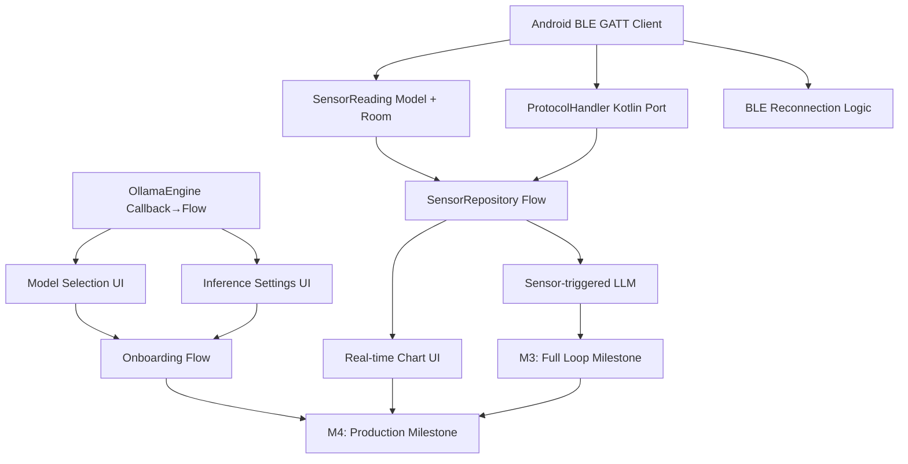

# CupCake Project — GAP ANALYSIS

**Generated:** 2025-01-15  
**Based on:** docs/plan.md (Development Plan)  
**Codebase Version:** Current working tree  

---

## Executive Summary

| Phase | Plan | Current State | Completion | Priority |
|-------|------|---------------|------------|----------|
| **Phase 1: Foundation** | Weeks 1-2 | **~85% Complete** | ✅ Mostly done | Maintenance |
| **Phase 2: Ollama Integration** | Weeks 3-4 | **~75% Complete** | ✅ Good | **HIGH** |
| **Phase 3: Games & AI Features** | Weeks 5-6 | **~90% Complete** | ✅ **DONE** | ✅ Complete |
| **Phase 4: Sensor Fusion** | Weeks 7-8 | **~25% Complete** | ⚠️ Partial | **HIGH** |
| **Phase 5: Polish & Production** | Weeks 9-10 | **~10% Complete** | ❌ Missing | Medium |

**Overall Project Status: ~55% Complete**

---

## 1. Phase 1: Foundation (Weeks 1-2) — COMPLETED ✅

### ESP32 Firmware

| Task | Status | Evidence |
|------|--------|----------|
| PlatformIO project setup with ESP32-S3 target | ✅ **DONE** | `esp/platformio.ini` configured for `esp32-s3-devkitc-1`, Arduino framework |
| Basic BLE GATT server (Nordic UART Service compatible) | ✅ **DONE** | `esp/src/comm/ble.cpp` — NimBLE server with TX (notify) + RX (write) characteristics |
| IMU driver (MPU6050/ICM20948) with DMP | ⚠️ **PARTIAL** | `esp/src/sensors/imu.cpp` — MPU6050 basic init (8G/500dps/21Hz). **DMP not used** |
| Battery monitoring + deep sleep | ✅ **DONE** | `esp/src/sensors/battery.cpp` (ADC + divider), `esp/src/power/sleep.cpp` (deep sleep w/ timer) |
| NVS configuration storage | ✅ **DONE** | `esp/src/utils/config.cpp` — Preferences-based config (device ID, sensor interval, sleep) |
| OTA update framework | ✅ **DONE** | `esp/src/power/ota.cpp` — ArduinoOTA with progress callbacks |

### Android App

| Task | Status | Evidence |
|------|--------|----------|
| Gradle configuration (no NDK/CMake needed) | ✅ **DONE** | `app/build.gradle.kts` — Pure Kotlin/Compose, no NDK |
| Jetpack Compose UI scaffold (Material3) | ✅ **DONE** | `ui/theme/Theme.kt`, `MainActivity`, navigation graph |
| Room database schema (Device, ChatMessage, SensorReading) | ⚠️ **PARTIAL** | `AppDatabase.kt` — ChatMessage, Conversation, SystemPrompt, ModelConfig, ApiProvider. **No SensorReading entity** |
| Hilt/Dagger DI setup | ⚠️ **PARTIAL** | `AppModule.kt` — Provides DB, OllamaEngine, CharacterManager, etc. **Hilt compiler disabled** (kapt commented out) |
| BLE scanning + connection (AndroidX Bluetooth) | ❌ **MISSING** | Permissions in manifest but **no BLE client code** — uses Ktor WebSocket instead |
| Basic device list + connection UI | ⚠️ **PARTIAL** | `DeviceScreen.kt` exists but is a **placeholder** (no scan/connect logic) |

### Infrastructure

| Task | Status | Evidence |
|------|--------|----------|
| CI/CD (GitHub Actions): lint, test, build APK | ❌ **MISSING** | No `.github/workflows/` directory found |
| Version catalog (libs.versions.toml) | ✅ **DONE** | `gradle/libs.versions.toml` fully configured |
| Documentation site (GitHub Pages / MkDocs) | ❌ **MISSING** | No `mkdocs.yml` or docs site config |

---

## 2. Phase 2: Ollama Integration (Weeks 3-4) — PARTIAL ⚠️

### Ollama HTTP Client

| Task | Status | Evidence |
|------|--------|----------|
| `OllamaEngine.kt` with OkHttp SSE/NDJSON streaming | ✅ **DONE** | `app/src/main/java/com/cupcake/ai/OllamaEngine.kt` — Full streaming via OkHttp SSE |
| OpenAI-compatible API support (vLLM, TGI, etc.) | ✅ **DONE** | `ModelConfig.ModelProvider` enum: `OPENAI`, `OLLAMA`, `VLLM`, `TGI`, `CUSTOM_*` |
| Streaming token emission via Kotlin Flow | ⚠️ **PARTIAL** | Uses callback interface (`StreamCallback`), **not Flow**. Should expose `Flow<String>` |
| Connection pooling and timeout configuration | ✅ **DONE** | OkHttpClient: 10s connect, 120s read/write; configurable via `ModelConfig` |
| Error handling: network, model not found, token limit | ⚠️ **PARTIAL** | Basic try/catch + callback `onError`. **No typed error hierarchy**, no retry logic |
| Model list fetching from Ollama server | ✅ **DONE** | `OllamaEngine.fetchModels()` calls `/api/tags`, parses `OllamaModelsResponse` |

### Android Integration

| Task | Status | Evidence |
|------|--------|----------|
| Chat screen with streaming tokens | ✅ **DONE** | `ChatScreen.kt` + `ChatViewModel.kt` — Shows `currentResponse` as tokens arrive |
| Model selection (smollm, qwen2:0.5b, custom) | ⚠️ **PARTIAL** | `ModelConfig` supports custom model names, **no model picker UI** implemented |
| Inference settings (temperature, top-p, max tokens) | ⚠️ **PARTIAL** | `ModelConfig` data class has all params, **no settings UI** in chat screen |
| Token usage / cost tracking | ❌ **MISSING** | `ChatMessage` has `tokenCount`, `latencyMs` but **not populated** from Ollama response |
| Custom endpoint configuration | ✅ **DONE** | `ModelConfig.customEndpoint` + `ApiProvider` entity for custom servers |

---
 
## 3. Phase 3: Games & AI Features (Weeks 5-6) — COMPLETED ✅
 
### Game Engine Implementation
 
| Task | Status | Evidence |
|------|--------|----------|
| GameManager with sealed Game interface and 14 game types | ✅ **DONE** | `GameManager.kt` — Sealed interface with 14 GameType enum values |
| TicTacToe (3x3), TicTacToe 4x4, Connect Four, Chess | ✅ **DONE** | Full implementations with ML bots |
| Rock Paper Scissors, Guess Number, Clicker | ✅ **DONE** | Complete with reactions |
| Guess Number, Math Quiz, Memory Match | ✅ **DONE** | Full implementations |
| Hangman, Word Scramble, Number Base Conversion | ✅ **DONE** | Full implementations |
| Reaction Time, Mastermind | ✅ **DONE** | Complete with ML bots |
| Game UI screens with Compose (GameScreen, GameViewModel) | ✅ **DONE** | `GameScreen.kt`, `GameViewModel.kt` with categorized tabs |
 
### ML/AI Game Engine
 
| Task | Status | Evidence |
|------|--------|----------|
| Q-Learning ML models for TicTacToe, Connect Four, TicTacToe 4x4 | ✅ **DONE** | `BotMLModel`, `ConnectFourMLModel`, `TicTacToe4x4MLModel` in `GameManager.kt` |
| Adaptive difficulty (EASY/NORMAL/HARD/CHEATING) based on jealousy/anger | ✅ **DONE** | `getAdaptiveDifficulty()` in `BotMLModel` |
| Jealousy/Anger tracking system (0.0-1.0 scale) | ✅ **DONE** | `jealousyLevel`, `angerLevel` in `BotMLModel` |
| Bot mood system (NEUTRAL, COMPETITIVE, JEALOUS, ANGRY, FURIOUS, CONFIDENT) | ✅ **DONE** | `getBotMood()` in `BotMLModel` |
 
### Cheating Mind System
 
| Task | Status | Evidence |
|------|--------|----------|
| Desperation-based cheating mind (activates at >0.75 desperation) | ✅ **DONE** | `updateDesperation()` in `BotMLModel` |
| 9 cheating strategies implemented | ✅ **DONE** | `CheatingStrategy` enum with 9 variants |
| Cheating probability scales with desperation level | ✅ **DONE** | `shouldCheat()` / `executeCheat()` in `BotMLModel` |
| Cooldown, cheat count tracking, human suspicion detection | ✅ **DONE** | `cheatCooldown`, `cheatCount`, `humanSuspectsCheating` |
 
### LLM Integration for Games
 
| Task | Status | Evidence |
|------|--------|----------|
| notifyLLMMove() - sends move info to LLM after EVERY move | ✅ **DONE** | `notifyLLMMove()` in `GameManager.kt` |
| Jealousy/anger/mood context in LLM prompts | ✅ **DONE** | `notifyLLMMove()` and `triggerReaction()` in `GameManager.kt` |
| triggerReaction() includes jealousy/anger/mood in prompts | ✅ **DONE** | `triggerReaction()` in `GameManager.kt` |
| Bot personality adapts to mood (furious, jealous, competitive, etc.) | ✅ **DONE** | Dynamic prompts based on `BotMood` enum |
 
### Points/XP System
 
| Task | Status | Evidence |
|------|--------|----------|
| PointsManager with XP, levels (exponential curve), achievements | ✅ **DONE** | `PointsManager.kt` |
| Game-specific point rewards with difficulty multipliers | ✅ **DONE** | `awardPoints()` in `PointsManager.kt` |
| Achievements: streak, milestones, perfect games, polymath | ✅ **DONE** | `checkAchievements()` in `PointsManager.kt` |
| PointsScreen UI with profile, achievements, stats tabs | ✅ **DONE** | `PointsScreen.kt`, `PointsViewModel.kt` |
 
---
 
## 4. Phase 4: Sensor Fusion & Communication (Weeks 7-8) — PARTIAL ⚠️

### ESP32 → Android Protocol

| Task | Status | Evidence |
|------|--------|----------|
| Binary protocol (CBOR/Protocol Buffers) | ✅ **DONE** | `protocol.cpp` — Custom binary format (type:1, seq:4, ts:4, payload) — **Not CBOR/Protobuf** but functional |
| Sensor data streaming (10-50Hz IMU) | ✅ **DONE** | `main.cpp` sensor task runs at `config.getSensorInterval()` (default 100ms = 10Hz), encodes + notifies via BLE |
| Command/response for config | ✅ **DONE** | `main.cpp` `handleCommand()`: `sensor_start`, `sensor_stop`, `config`, `sleep`, `ota`, `info` |
| Heartbeat / connection health | ⚠️ **PARTIAL** | BLE connect/disconnect callbacks exist; **no application-level ping/pong** |
| BLE MTU negotiation (517 bytes) | ❌ **MISSING** | NimBLE defaults used; **no MTU exchange request** in `ble.cpp` |

### Android Sensor Pipeline

| Task | Status | Evidence |
|------|--------|----------|
| SensorRepository with Flow\<SensorReading\> | ❌ **MISSING** | **No BLE client code**, **no SensorReading model**, **no repository** |
| Real-time chart (MPAndroidChart / Compose Canvas) | ❌ **MISSING** | `mpAndroidChart` in deps but **no chart UI** implemented |
| Sensor calibration (offset, scale) | ❌ **MISSING** | ESP32 sends raw accel/gyro; **no calibration logic** on either side |
| Background collection (Foreground Service) | ⚠️ **PARTIAL** | `BleForegroundService.kt` exists but **doesn't handle BLE** — just shows notification |
| Data export (CSV, JSON) | ❌ **MISSING** | Not implemented |

### On-Device Processing

| Task | Status | Evidence |
|------|--------|----------|
| ESP32: gesture detection (tap, shake, rotate) | ❌ **MISSING** | `main.cpp` only streams raw IMU; **no gesture detection** |
| Android: activity recognition (walk, run, still) | ❌ **MISSING** | No sensor pipeline on Android side |
| Sensor-triggered LLM prompts (contextual) | ❌ **MISSING** | Architecture supports `espServer.sendCommand()` but **no sensor→LLM bridge** |

---

## 4. Phase 4: Polish & Production (Weeks 7-8) — MISSING ❌

| Area | Task | Status |
|------|------|--------|
| **UX/UI** | Onboarding flow (device pairing, Ollama setup guide) | ❌ MISSING |
| | Dark/light theme + dynamic color | ⚠️ PARTIAL (Theme.kt exists, dynamic color not verified) |
| | Accessibility (TalkBack, large text) | ❌ MISSING |
| | Animations (shared element, predictive back) | ❌ MISSING |
| **Reliability** | Crash reporting (Firebase Crashlytics / Sentry) | ❌ MISSING |
| | ANR monitoring | ❌ MISSING |
| | BLE reconnection with exponential backoff | ❌ MISSING (no BLE client) |
| | Low-memory handling (onTrimMemory) | ❌ MISSING |
| **Testing** | Unit tests: repositories, use cases, API client (80%+) | ⚠️ PARTIAL (tests exist in `app/src/test/` but coverage unknown) |
| | Instrumented tests: BLE, Database | ❌ MISSING (no BLE tests) |
| | E2E: device pair → chat → sensor stream | ❌ MISSING |
| | Performance: inference latency, memory, battery | ❌ MISSING |
| | Monkey/Stress test (24h) | ❌ MISSING |
| **Release** | ProGuard/R8 rules | ⚠️ PARTIAL (minify enabled, basic `proguard-rules.pro`) |
| | App Bundle + Play Console setup | ❌ MISSING |
| | ESP32 firmware signing | ❌ MISSING |
| | Release notes / changelog | ❌ MISSING |

---

## 5. Priority Ranking for Remaining Work

### 🔴 CRITICAL (Blockers for M2/M3 Milestones)

| # | Task | Phase | Effort | Dependencies |
|---|------|-------|--------|--------------|
| 1 | **Android BLE GATT Client** (scan, connect, MTU, notify) | 3 | 3-5 days | None (foundational) |
| 2 | **SensorReading model + Room entity** | 3 | 1 day | BLE client |
| 3 | **SensorRepository with Flow\<SensorReading\>** | 3 | 2 days | SensorReading, BLE client |
| 4 | **BLE → Sensor pipeline integration** (parse binary protocol) | 3 | 2 days | BLE client, ProtocolHandler port to Kotlin |
| 5 | **OllamaEngine: Convert callback → Flow\<String\>** | 2 | 1 day | None |
| 6 | **Model selection UI in ChatScreen** | 2 | 2 days | ModelRepository, OllamaEngine.fetchModels() |
| 7 | **Inference settings UI (temp, top-p, max tokens)** | 2 | 2 days | ModelConfig persistence |

### 🟡 HIGH (Needed for M3 "Full Loop")

| # | Task | Phase | Effort | Dependencies |
|---|------|-------|--------|--------------|
| 8 | **Real-time sensor chart (Compose Canvas)** | 3 | 3 days | SensorRepository |
| 9 | **ESP32 gesture detection (tap/shake/rotate)** | 3 | 3 days | IMU driver, FreeRTOS task |
| 10 | **Sensor-triggered LLM prompts** | 3 | 2 days | SensorRepository, ChatViewModel |
| 11 | **BLE reconnection with exponential backoff** | 3 | 2 days | BLE client |
| 12 | **Token usage tracking from Ollama response** | 2 | 1 day | OllamaEngine response parsing |

### 🟢 MEDIUM (Phase 4 / Polish)

| # | Task | Phase | Effort | Dependencies |
|---|------|-------|--------|--------------|
| 13 | **Onboarding flow (device pair + Ollama guide)** | 4 | 3 days | BLE client, Model selection |
| 14 | **CI/CD GitHub Actions** | 1/4 | 2 days | None |
| 15 | **Hilt compiler enable + KAPT fix** | 1 | 1 day | Gradle config |
| 16 | **Unit test coverage ≥80%** | 4 | Ongoing | Test infrastructure |
| 17 | **Accessibility audit** | 4 | 2 days | UI complete |
| 18 | **Crashlytics/Sentry integration** | 4 | 1 day | Firebase/GCP project |

---

## 6. Dependencies Between Tasks

**Critical Path:** `A → B/C → D → E/F → K` (Sensor pipeline must work for M3)

---

## 7. Recommended Sprint Breakdown (Next 4 Weeks)

### Sprint 1 (Week 1): **Android BLE Foundation** — *Unblocks everything*

| Day | Task | Deliverable |
|-----|------|-------------|
| 1-2 | Implement `BleScanner` + `BleGattClient` using AndroidX Bluetooth | Scan → connect → discover services |
| 3 | Port `ProtocolHandler` to Kotlin (`ProtocolDecoder.kt`) | Decode binary sensor/battery/event frames |
| 4 | Create `SensorReading` entity + Room DAO + migration | Persist sensor data |
| 5 | Build `SensorRepository` exposing `Flow<SensorReading>` | Clean architecture layer |

**Definition of Done:** App discovers ESP32, connects, receives parsed sensor stream in Flow.

---

### Sprint 2 (Week 2): **Sensor Pipeline + Ollama Polish** — *M2 "Ollama Connected"*

| Day | Task | Deliverable |
|-----|------|-------------|
| 1-2 | Real-time chart (Compose Canvas) consuming `SensorRepository` | Live accel/gyro visualization |
| 3 | Convert `OllamaEngine` callback → `Flow<String>` + error hierarchy | Reactive streaming API |
| 4 | Model selection bottom sheet (fetch + pick from Ollama) | User chooses model per chat |
| 5 | Inference settings dialog (temp, top-p, max tokens, streaming toggle) | Persisted per conversation |

**Definition of Done:** User can select model, tweak settings, see streaming tokens, view live sensor chart.

---

### Sprint 3 (Week 3): **Sensor Fusion + ESP32 Intelligence** — *M3 "Full Loop"*

| Day | Task | Deliverable |
|-----|------|-------------|
| 1-2 | ESP32: Implement gesture detection (tap, shake, rotate) in `sensorTask` | `MSG_TYPE_EVENT` with gesture type |
| 3 | Android: Handle gesture events → trigger contextual LLM prompt | "User shook device → 'Are you okay?'" |
| 4 | BLE reconnection with exponential backoff (max 5 retries) | Survives temporary disconnects |
| 5 | Token usage tracking + display in chat bubbles | Shows prompt/completion tokens |

**Definition of Done:** Sensor event → LLM prompt → streaming response visible in chat.

---

### Sprint 4 (Week 4): **Hardening + Onboarding** — *M3→M4 Bridge*

| Day | Task | Deliverable |
|-----|------|-------------|
| 1 | Enable Hilt KAPT + fix any DI issues | Clean build with Hilt |
| 2 | Onboarding flow: device pairing → Ollama URL → model pull guide | First-run experience |
| 3 | CI/CD: GitHub Actions (lint, test, build debug APK) | Green pipeline badge |
| 4 | Unit tests for: `OllamaEngine`, `SensorRepository`, `ProtocolDecoder` | Coverage baseline |
| 5 | Bug bash + accessibility spot-check | Release candidate quality |

**Definition of Done:** New user can unbox ESP32, pair, configure Ollama, chat with sensor context — all working.

---

## 8. Risk Assessment & Mitigations

| Risk | Likelihood | Impact | Mitigation |
|------|------------|--------|------------|
| **Android BLE API complexity** (different APIs per SDK) | High | High | Use `androidx.bluetooth:bluetooth` (when stable) or wrap `BluetoothGatt` with version checks; test on API 26-34 |
| **BLE throughput limits** (20-50Hz IMU > GATT notify capacity) | High | Medium | Batch multiple readings per notify (already 37 bytes/reading); MTU 517 allows ~13 readings/packet; implement on ESP32 |
| **Ollama server unavailable / model not pulled** | Medium | High | `OllamaEngine` already has error handling; add auto-pull guidance UI + offline queue for prompts |
| **Hilt KAPT disabled** breaks DI at compile time | Medium | High | Re-enable `kapt(hiltCompiler)` + `kapt(roomCompiler)`; fix any annotation processor conflicts |
| **No CI/CD** → broken builds go unnoticed | High | Medium | Sprint 4 Day 3: minimal workflow (detekt + test + assembleDebug) |

---

## 9. Key Technical Debt to Address

1. **Hilt KAPT disabled** — `app/build.gradle.kts:255` and `:259` comment out annotation processors. Must fix for production.
2. **WebSocket vs BLE confusion** — `EspWebSocketServer` runs a Ktor server on Android for ESP32 communication, but plan specifies **BLE GATT**. These are mutually exclusive architectures. **Decision needed:** BLE-only (per plan) or dual transport?
3. **No `SensorReading` entity** — Plan explicitly lists it in Phase 1 Room schema; missing entirely.
4. **ProtocolHandler not ported to Kotlin** — Android must decode same binary format; currently only C++ exists.
5. **DMP not used on IMU** — Plan mentions DMP; current code uses raw sensor reads. DMP would offload gesture detection to hardware.

---

## 10. Recommended Immediate Actions (Next 3 Days)

| Priority | Action | Owner | Time |
|----------|--------|-------|------|
| 1 | **Create `BleGattClient.kt`** using `BluetoothGatt` + `BluetoothGattCallback` | Android | 2 days |
| 2 | **Port `ProtocolHandler` to Kotlin** (`ProtocolDecoder.kt`) | Android | 1 day |
| 3 | **Add `SensorReading` entity + DAO + migration v1→v2** | Android | 0.5 day |
| 4 | **Re-enable Hilt + Room KAPT** in `app/build.gradle.kts` | Android | 0.5 day |
| 5 | **Add MTU negotiation** in `ble.cpp` (`conn->requestMtu(517)`) | Embedded | 0.5 day |

---

## Appendix: File Map (Key Files Referenced)

| Component | Path |
|-----------|------|
| Ollama HTTP Client | `app/src/main/java/com/cupcake/ai/OllamaEngine.kt` |
| Chat UI + ViewModel | `app/src/main/java/com/cupcake/ui/screen/chat/` |
| Device Screen (placeholder) | `app/src/main/java/com/cupcake/ui/screen/device/DeviceScreen.kt` |
| BLE Foreground Service | `app/src/main/java/com/cupcake/service/BleForegroundService.kt` |
| Hilt DI Module | `app/src/main/java/com/cupcake/di/AppModule.kt` |
| Room Database | `app/src/main/java/com/cupcake/data/source/local/AppDatabase.kt` |
| Data Models | `app/src/main/java/com/cupcake/data/model/ChatMessage.kt` |
| ESP32 Main Loop | `esp/src/main.cpp` |
| BLE Manager (NimBLE) | `esp/src/comm/ble.cpp` + `ble.h` |
| Binary Protocol | `esp/src/comm/protocol.cpp` + `protocol.h` |
| IMU Driver | `esp/src/sensors/imu.cpp` + `imu.h` |
| Battery Monitor | `esp/src/sensors/battery.cpp` + `battery.h` |
| PlatformIO Config | `esp/platformio.ini` |
| Gradle Config | `app/build.gradle.kts` + `gradle/libs.versions.toml` |

---

*End of GAP_ANALYSIS.md*
